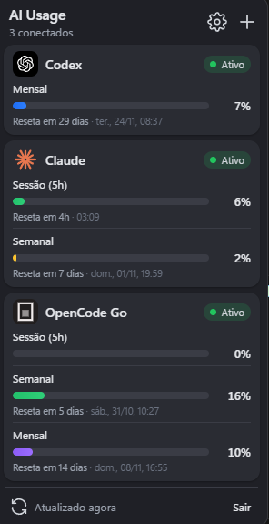

# AI Usage Monitor

A small Windows tray app that shows how much of your **Codex** (ChatGPT), **Claude** and **OpenCode Go** plan limits you have used — session and weekly bars, time until reset, and automatic refresh. No more opening a CLI or a web page just to check if you are close to the limit.

<p align="center">
  
</p>

## Features

- **Live usage bars** for each limit window (5-hour session, weekly, per-model weekly), with percentage used.
- **Reset countdown** plus the exact reset time ("Resets in 2h · 01:39 PM").
- **Color alerts** — a bar turns red at 90% or more.
- **Auto refresh** every 1, 5, 15 or 30 minutes, plus a manual sync button.
- **Two ways to connect**: sign in inside the app, or reuse the login your CLI already has.
- **Tray-first**: no taskbar entry; left click toggles the panel, right click opens the menu.
- **Light / dark theme** following the Windows setting.
- **English and Português (Brasil)**, with an option to follow the system language.
- **Start with Windows** and **automatic updates**.

## Install

Download the latest installer (`.exe` or `.msi`) from the [Releases page](https://github.com/SrWalkerB/ai-usage-bar/releases), run it, and look for the icon in the system tray. The app updates itself when a new version is published.

> Windows only for now.

## Getting started

1. Click the tray icon to open the panel.
2. Press **+** (Add provider) and pick Codex, Claude or OpenCode Go.
3. Follow the sign-in steps below. Usage appears right after the first sync.


### Connecting

| Provider | Login | Shortcut |
| --- | --- | --- |
| Codex | Device code (ChatGPT account) | "Use Codex CLI login" reads `~/.codex/auth.json` |
| Claude | OAuth: open the login page, paste the code shown at the end | "Use Claude Code login" reads `~/.claude/.credentials.json` |
| OpenCode Go | No login: "Use local OpenCode data" | Reads `~/.local/share/opencode/opencode.db` |

- Tokens from the app's own login are stored in `%APPDATA%\dev.walker.aiusage\data.json` and refreshed automatically.
- "Via CLI" connections re-read the CLI's file on every sync and **never** refresh it (refresh tokens rotate; refreshing would log the CLI out). If the CLI's token expires, open the CLI once.

### Settings

Open the gear icon to change the language, the refresh interval and whether the app starts with Windows, and to disconnect an account.

## How usage is read

- **Codex:** `GET https://chatgpt.com/backend-api/wham/usage` → `rate_limit.primary_window` / `secondary_window`.
- **Claude:** `GET https://api.anthropic.com/api/oauth/usage` → `five_hour`, `seven_day`, `seven_day_opus`, `seven_day_sonnet`.
- **OpenCode Go:** no usage API exists, so the cost of `opencode-go` messages in the local OpenCode database is summed over rolling 5-hour / 7-day / 30-day windows and compared with the Go plan limits ($12 / $30 / $60). Only usage from this machine is counted.

Each window's kind (session / daily / weekly) comes from its length, not its position, and only windows the API returns are drawn — plans with only a weekly limit show a single bar.

> These are internal endpoints used by the official CLIs and may change without notice.

## Development

Stack: [Tauri 2](https://tauri.app) (Rust) + React 19 + TypeScript + Vite.

Requirements: Node.js 22+, [pnpm](https://pnpm.io), a [Rust toolchain](https://rustup.rs) and the [Tauri prerequisites for Windows](https://tauri.app/start/prerequisites/).

```sh
pnpm install
pnpm tauri dev      # run in development
pnpm tauri build    # installers in src-tauri/target/release/bundle
```

### Project layout

```
src/            React UI (panel, provider cards, settings, i18n)
src-tauri/src/  Rust backend: tray, providers (codex.rs, claude.rs, opencode_go.rs), storage
docs/           README screenshots
```

### Releasing

Pushing a tag like `v0.1.1` runs the **Release** workflow, which builds the Windows installers, signs the updater artifacts and creates a draft GitHub release.

> The screenshots in `docs/screenshots` use sample data, not a real account.
